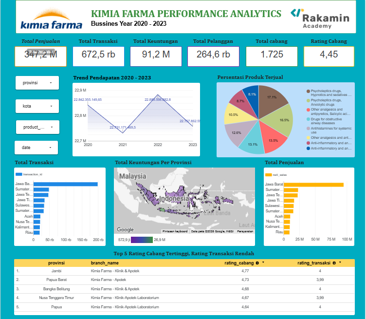

# Program Project Based Internship - Kimia Farma Big Data Analytics
Project ini merupakan analisis data bisnis Kimia Farma selama periode 2020–2023 yang bertujuan untuk mengevaluasi kinerja perusahaan berdasarkan data transaksi, produk, inventori, dan cabang.

Sebagai Data Analyst, saya melakukan proses pengolahan, penggabungan, dan analisis data menggunakan Google BigQuery serta menyajikan hasil analisis dalam bentuk dashboard interaktif menggunakan Google Looker Studio. Hasil analisis diharapkan dapat memberikan informasi yang bermanfaat sebagai dasar evaluasi dan pengambilan keputusan bisnis.

## Tujuan Project

1. Menganalisis perkembangan penjualan dan keuntungan Kimia Farma.
2. Mengidentifikasi produk dengan kontribusi penjualan tertinggi.
3. Menganalisis performa transaksi berdasarkan wilayah dan cabang.
4. Mengevaluasi hubungan antara rating cabang dan rating transaksi.
5. Memberikan rekomendasi berdasarkan hasil analisis data.

## Sumber Data
Proyek ini menggunakan empat dataset utama:

* kf_final_transaction: Data transaksi penjualan.
* kf_kantor_cabang: Data informasi kantor cabang.
* kf_product: Data informasi produk.
* kf_inventory: Data persediaan produk.

[Kimia Farma 2020 - 2023](https://app.rakamin.com/virtual-internship-experience/kimiafarma-big-data-analytics-virtual-internship-program)

## Hasil Dashboard Analytics 
Adapun berikut hasil dashboard analytics mengenai performa penjualan PT Kimia Farma periode 2020-2023 yakni sebagai berikut.  

  

[DASHBOARD_KIMIA FARMA PERFORMANCE ANALYTICS](https://datastudio.google.com/reporting/f7010074-c2db-492a-a8c7-f0b7d1b3d7d5) 

Author: Ikbal Amin  
Role: Data Analyst   
Education: S1 Informatika – Universitas Gunadarma

Tools: SQL | Google BigQuery | Google Looker Studio
